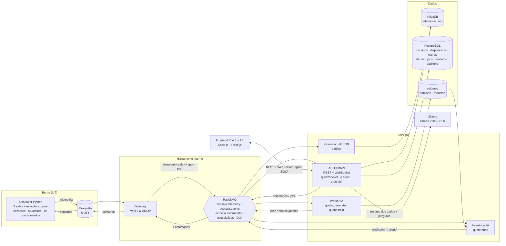

# EcoSala AIoT — 2º bimestre

> **Smart Campus**: monitoramento do conforto ambiental das salas de aula (problema do 1º bimestre)
> evoluído para uma aplicação **AIoT completa** — Web + IoT + Inteligência Artificial — com
> **manutenção preditiva dos ar-condicionados** de cada sala.

Simulador IoT (Python) → **MQTT/Mosquitto** → gateway → **RabbitMQ** → InfluxDB / IA / WebSocket →
**Vue 3 + TypeScript** (dashboard, gêmeo digital **Three.js**, insights, laboratório de dados, treino,
mensageria e **assistente com LLM local no Ollama**). Tudo sobe com **um único comando** no Docker Compose.

## Integrantes do grupo

- Luis Fernando Barbosa Filho - 25575
- Arthur do Amaral Carvalhais Pereira - 25403
- Cauã Mendonça Martello - 25557
- Raul Ricardo de Mello - 27199
- Guilherme Souza de Andrea - 25615

## Sumário

- [O problema e a evolução](#o-problema-e-a-evolução)
- [Arquitetura](#arquitetura)
- [Como subir com Docker Compose](#como-subir-com-docker-compose)
- [Usuários de demonstração](#usuários-de-demonstração)
- [Páginas da aplicação](#páginas-da-aplicação)
- [Sensores, atuadores e equipamento monitorado](#sensores-atuadores-e-equipamento-monitorado)
- [Mensageria (RabbitMQ)](#mensageria-rabbitmq)
- [Dados sintéticos e modelos de IA](#dados-sintéticos-e-modelos-de-ia)
- [Assistente com LLM local](#assistente-com-llm-local)
- [Segurança](#segurança)
- [Como rodar cada parte da demonstração](#como-rodar-cada-parte-da-demonstração)
- [Testes automatizados](#testes-automatizados)
- [Estrutura do repositório](#estrutura-do-repositório)
- [Solução de problemas](#solução-de-problemas)

## O problema e a evolução

O 1º bimestre resolveu a falta de dados sobre **temperatura, umidade e luminosidade** das salas
(ESP32 + MQTT + FastAPI + InfluxDB + Vue). O código do 1º bimestre está preservado em
[`legado-1bim/`](legado-1bim/) e o firmware ESP32/Wokwi em [`firmware/`](firmware/).

No 2º bimestre o mesmo problema ganha:

| | 1º bimestre | 2º bimestre |
|---|---|---|
| Dispositivo | ESP32 (Wokwi) | Simulador Python com 3 salas + estação externa |
| Sensores | temperatura, umidade, luminosidade | + CO₂ (qualidade do ar), presença, estação externa |
| Atuadores | — | ventilação (automática por regra), iluminação (Web), sinalização (alerta da IA), ar-condicionado (Web) |
| Equipamento monitorado | — | **ar-condicionado de cada sala**: vibração, corrente, temperatura de descarga |
| Mensageria | — | RabbitMQ como barramento interno (8 filas + DLQ) |
| Bancos | InfluxDB | InfluxDB (telemetria) + PostgreSQL (cadastros, regras, alertas, auditoria) |
| IA | — | gerador de dados sintéticos massivos + 2 modelos de regressão + inferência em tempo real |
| Interface | dashboard e histórico | + gêmeo digital 3D, insights, laboratório, treino, mensageria, assistente LLM |
| Infra | binários locais | Docker Compose com healthchecks, usuários sem root, segredos fora do Git |

## Arquitetura



**Três fluxos obrigatórios**

1. **IoT → Web**: simulador → MQTT → gateway → RabbitMQ (`ecosala.telemetry`) → gravador → InfluxDB; e
   `q.websocket` → API → WebSocket → dashboard e cena 3D.
2. **Web → IoT**: botão no dashboard → `POST /api/v1/devices/{id}/command` → RabbitMQ (`ecosala.commands`,
   fila `q.commands`) → gateway → MQTT `ecosala/v1/<sala>/<nó>/command` → simulador muda o atuador →
   o efeito aparece nas leituras seguintes (ex.: iluminação ligada ⇒ luminosidade sobe ~450 lux;
   ventilação ligada ⇒ temperatura e CO₂ caem) e o simulador devolve um *ack*.
3. **IA**: Laboratório (`q.jobs.generate`) gera os dados sintéticos → Treino (`q.jobs.train`) cria os
   modelos → a inferência (`q.inference`) aplica-os à telemetria ao vivo → previsões e alertas voltam
   pelo RabbitMQ (`ecosala.events`) até a interface.

**Papel de cada banco**: o **InfluxDB** guarda leituras e telemetria (sensores, atuadores, equipamentos e
previsões) e, em um bucket separado `lab`, uma amostra dos dados sintéticos. O **PostgreSQL** guarda
usuários, dispositivos, configurações, regras, alertas, jobs, versões de modelo e auditoria.

Detalhes: [`docs/arquitetura.md`](docs/arquitetura.md) · contrato MQTT/AMQP: [`docs/contratos.md`](docs/contratos.md).

## Como subir com Docker Compose

Pré-requisitos: **Docker Desktop** (Windows/macOS) ou Docker Engine + Compose v2 (Linux), Python 3
(só para gerar os segredos) e **pelo menos 8 GB de memória para o Docker**. No Windows, crie/edite
`%UserProfile%\.wslconfig`:

```ini
[wsl2]
memory=8GB
```

e rode `wsl --shutdown` antes de abrir o Docker Desktop de novo.

```powershell
git clone https://github.com/LuisBarbosaa/ecosala.git
cd ecosala
python scripts/gerar_segredos.py      # uma única vez: cria .env e credenciais-demo.txt (fora do Git)
docker compose up -d --build          # sobe TUDO (1ª vez demora: imagens + download do LLM ~2 GB)
docker compose ps                     # todos devem ficar "healthy" (rabbit-init e ollama-init terminam com "Exited (0)")
```

Abra **http://localhost:8080** e entre com um dos usuários de demonstração.

O que acontece na primeira subida:

- `rabbit-init` cria vhost, usuários por serviço, exchanges, filas, bindings e DLQ (e remove o `guest`);
- a API cria as tabelas no PostgreSQL e o catálogo inicial (3 salas, 29 dispositivos e 9 regras);
- o `worker` gera um dataset inicial (≈4,1 milhões de leituras) e treina a versão 1 dos modelos
  automaticamente (~1–2 min), para os insights já aparecerem;
- o `ollama-init` baixa o `llama3.2:3b` e deixa o modelo pré-carregado na memória.

Comandos úteis:

```powershell
docker compose logs -f api simulator inference   # acompanhar logs
docker compose down                              # parar (mantém os dados)
docker compose down -v                           # parar e APAGAR os dados (volumes)
```

## Usuários de demonstração

As senhas são **aleatórias** e ficam somente no `credenciais-demo.txt` gerado pelo script (não versionado).

| Usuário | Papel | Pode |
|---|---|---|
| `visualizador` | visualizador | só vê |
| `operador` | operador | comanda atuadores, injeta falhas e pausa/retoma o simulador |
| `administrador` | administrador | tudo acima + gera dados, treina modelos, cadastra dispositivos/regras e vê a auditoria |

## Páginas da aplicação

| Página | O que mostra |
|---|---|
| **Dashboard** | indicadores, gráficos ao vivo (temperatura, CO₂, vibração), cada sala com sensores, atuadores (botões Ligar/Desligar), saúde da IA |
| **Histórico** | consulta ao InfluxDB por dispositivo/medida/período com estatísticas e tabela |
| **Gêmeo 3D** | campus em Three.js movido só pelo WebSocket; clique em qualquer item para o painel |
| **Insights** | saúde, vida útil restante, tendência e alertas por ar-condicionado; injetar falha / reparar |
| **Dispositivos** | cadastro (CRUD) dos dispositivos e edição das regras de negócio |
| **Laboratório** | gerador de dados sintéticos configurável, volume estimado e progresso ao vivo |
| **Treinamento** | dispara o treino, versão em uso, MAE/RMSE/R², base simples, previsto×real, importância dos atributos |
| **Mensageria** | filas, taxas, consumidores, últimas mensagens e DLQ do RabbitMQ (ao vivo) |
| **Assistente** | chat com o LLM local em streaming |
| **Auditoria** | logins, comandos, jobs, perguntas ao assistente (administrador) |
| **Infra** | links das interfaces do RabbitMQ, InfluxDB, pgAdmin e Swagger; saúde da API |

A documentação da API (Swagger) fica em **http://localhost:8080/docs**.

## Sensores, atuadores e equipamento monitorado

Por sala (`sala-101`, `sala-102`, `lab-201`) + estação externa:

- **Sensores (5 por sala + 2 externos)**: temperatura, umidade, luminosidade, CO₂, presença;
  temperatura e luminosidade externas (dia/noite).
- **Atuadores**: `vent-*` ventilação — **automática por regra** (temperatura > 28 °C ou CO₂ > 1200 ppm, com
  histerese); `luz-*` iluminação — **controlada pela Web**; `alarme-*` sinalização — ligada
  automaticamente por **alerta crítico da IA**; `ac-*` ar-condicionado — liga/desliga pela Web.
- **Equipamento monitorado**: `ac-*` (compressor do ar-condicionado) com **vibração (mm/s), corrente (A) e
  temperatura de descarga (°C)**, que sobem aos poucos quando ele degrada.

Tempo simulado acelerado: cada leitura (a cada 2 s reais) representa **10 minutos**. Um dia simulado dura
≈5 min reais — dá para ver dia/noite e a ocupação das aulas na cena 3D. O `ac-201` começa com um desgaste
natural lento de rolamento; nos outros, injete falhas pela página Insights.

## Mensageria (RabbitMQ)

| Fila | Consumidor | Bindings |
|---|---|---|
| `q.influx` | gravador InfluxDB | `telemetry.#`, `prediction.#` |
| `q.inference` | inferência IA | `telemetry.*.equipment.*`, `model.updated` |
| `q.websocket` | API → navegadores | `#` (telemetria e eventos) |
| `q.commands` | gateway → MQTT | `command.#` |
| `q.rules` | API (motor de regras) | `telemetry.*.temperature.*`, `telemetry.*.co2.*`, `alert.#` |
| `q.persist` | API (PostgreSQL) | `alert.#`, `job.#`, `model.#` |
| `q.jobs.generate` / `q.jobs.train` | worker IA | `job.generate` / `job.train` |
| `q.dlq` | (inspeção) | todas as filas têm `x-dead-letter-exchange: ecosala.dlx` |

Mensagens em JSON com formato único: `{id, ts, type, device, room, payload}`. Cada serviço tem um usuário
próprio com permissões mínimas (ex.: o gateway só escreve em `ecosala.telemetry` e só lê `q.commands`);
o usuário `guest` não existe. Mais em [`docs/contratos.md`](docs/contratos.md).

## Dados sintéticos e modelos de IA

- **Gerador** (`backend/ecosala_common/synthetic.py`): numpy vetorizado por equipamento, em blocos,
  com teto de 40 milhões de leituras. Parâmetros na interface: equipamentos, sensores de cada tipo,
  dias, % que falham, modos de falha (rolamento, superaquecimento, entupimento, desbalanceamento, deriva e
  travamento de sensor), ruído, % faltantes, % outliers e semente. Ciclo diário/sazonal, variação entre
  máquinas (sobreposição entre saudáveis e doentes) e rótulos de verdade (`degrading`, `rul_h`, `health`)
  que **nunca** são enviados em tempo real. O mesmo modelo físico (`physics.py`) é usado pelo simulador.
- **Features** (`features.py`): um único código para treino e inferência; janelas só olham o passado
  (média, desvio, máximo, tendência de 1 h e 24 h, resíduos em relação ao esperado para a carga).
- **Modelos** (`ml.py`): `HistGradientBoostingRegressor` para **vida útil restante (h)** e **índice de
  saúde (0–100)**. Divisão treino/validação/teste **por equipamento** (estratificada entre máquinas que
  falham e não falham). Métricas MAE, RMSE e R², comparação com a **base simples (média)** — o modelo só
  entra em uso se vencer a base —, previsto × real e importância dos atributos (permutação).
- **Inferência** (`inference/`): consome a telemetria ao vivo, publica previsões e alertas com
  **histerese** (3 previsões seguidas abaixo do limite para disparar, 10 acima para limpar) e recarrega o
  modelo novo **sem reiniciar** ao receber `model.updated`.

Resultado típico (padrão da interface: 100 equipamentos, 90 dias, ≈10,4 milhões de leituras): R² de teste ≈ 0,6–0,75 nos dois
alvos, com MAE cerca de metade da base simples.

## Assistente com LLM local

`llama3.2:3b` no Ollama (container do Compose, CPU, sem chave de API e sem nuvem). O backend monta um
**resumo pronto** dos dados atuais (leituras, saúde/RUL, alertas abertos, métricas do modelo e arquitetura)
e envia junto com a pergunta — o LLM nunca acessa os bancos. A resposta chega em **streaming** (NDJSON),
a interface mostra "carregando o modelo", o Markdown é renderizado **sem HTML e sem imagens**, há limite
de 6 perguntas/minuto por usuário e cada pergunta vai para a auditoria. O botão "Ver resumo enviado ao
LLM" mostra exatamente o contexto.

## Segurança

- Login com **JWT** e três papéis; senhas com **bcrypt**; bloqueio após 5 tentativas erradas (5 min) e
  limite por IP.
- Nenhum segredo no Git: `.env` e `credenciais-demo.txt` gerados por `scripts/gerar_segredos.py`.
- Mosquitto **sem anônimo**, usuários `device` e `gateway` com **ACL por tópico**.
- RabbitMQ com **um usuário por serviço** e sem `guest`.
- WebSocket abre com **ticket curto de uso único** (`POST /api/v1/auth/ws-ticket`), nunca com o JWT na URL.
- Containers da aplicação rodam como usuário **sem root** (uid 10001; frontend em nginx-unprivileged).
- Só a porta **8080** (frontend + proxy da API) é publicada; RabbitMQ, InfluxDB e pgAdmin ficam em
  **127.0.0.1** para exploração em aula.
- Tabela `audit_log` com logins, comandos (usuário e regra), jobs e perguntas.

## Como rodar cada parte da demonstração

Roteiro completo na ordem da apresentação: [`docs/roteiro-demonstracao.md`](docs/roteiro-demonstracao.md).

Resumo dos comandos:

```powershell
docker compose ps                                                  # 1. containers saudáveis
docker compose exec mosquitto sh -c 'mosquitto_sub -u gateway -P "$MQTT_GATEWAY_PASSWORD" -t "ecosala/#" -v -C 5'   # 3. MQTT
# 4. Swagger: http://localhost:8080/docs
docker compose stop influx-writer   # 5. q.influx cresce na página Mensageria
docker compose start influx-writer  #    e esvazia
```

## Testes automatizados

```powershell
docker compose run --rm --no-deps api python -m pytest -q
```

35 testes: envelope, topologia, features sem vazamento de dados, gerador (reprodutível, degradação
progressiva, teto), divisão por equipamento, treino vencendo a base, regras com histerese (e duas regras no mesmo atuador), alertas com
histerese, gateway, simulador (atuador muda a leitura, falha/reparo) e API (login, bloqueio, papéis,
comandos, ticket do WebSocket, OpenAPI).

## Estrutura do repositório

```
├── docker-compose.yml        # todos os serviços
├── scripts/gerar_segredos.py # cria .env com senhas aleatórias
├── backend/                  # imagem Python única para todos os serviços
│   ├── ecosala_common/       # envelope, topologia, física, features, gerador, ML, heartbeat
│   ├── api/                  # FastAPI: REST, WebSocket, consumidores, regras, assistente
│   ├── gateway/              # MQTT ⇄ RabbitMQ
│   ├── influx_writer/        # q.influx → InfluxDB
│   ├── inference/            # q.inference → previsões e alertas
│   ├── worker/               # jobs de geração e treino
│   ├── simulator/            # dispositivo simulado (sensores, atuadores, ar-condicionados)
│   ├── rabbit_init/          # cria a topologia e os usuários do RabbitMQ
│   └── tests/
├── frontend/                 # Vue 3 + TypeScript + Vite + Chart.js + Three.js (nginx)
├── infra/                    # Mosquitto (conf, ACL), InfluxDB, Ollama, pgAdmin
├── docs/                     # arquitetura, contratos, roteiro da demonstração
├── firmware/                 # ESP32/Wokwi do 1º bimestre
└── legado-1bim/              # backend/frontend do 1º bimestre
```

## Solução de problemas

- **`rode scripts/gerar_segredos.py`** ao subir: o `.env` não existe. Rode o script.
- **Assistente demora / "baixando o modelo"**: na primeira subida o `ollama-init` baixa ~2 GB. Veja
  `docker compose logs -f ollama-init`. Em CPU a primeira resposta leva mais; depois fica pré-carregado.
- **Sem memória / containers reiniciando**: aumente a memória do Docker/WSL2 para 8 GB.
- **Mudou o `.env` depois de subir**: os bancos guardam as senhas antigas. Rode `docker compose down -v`
  e suba de novo.
- **Porta 8080 ocupada**: troque `"8080:8080"` em `docker-compose.yml` (serviço `frontend`).
