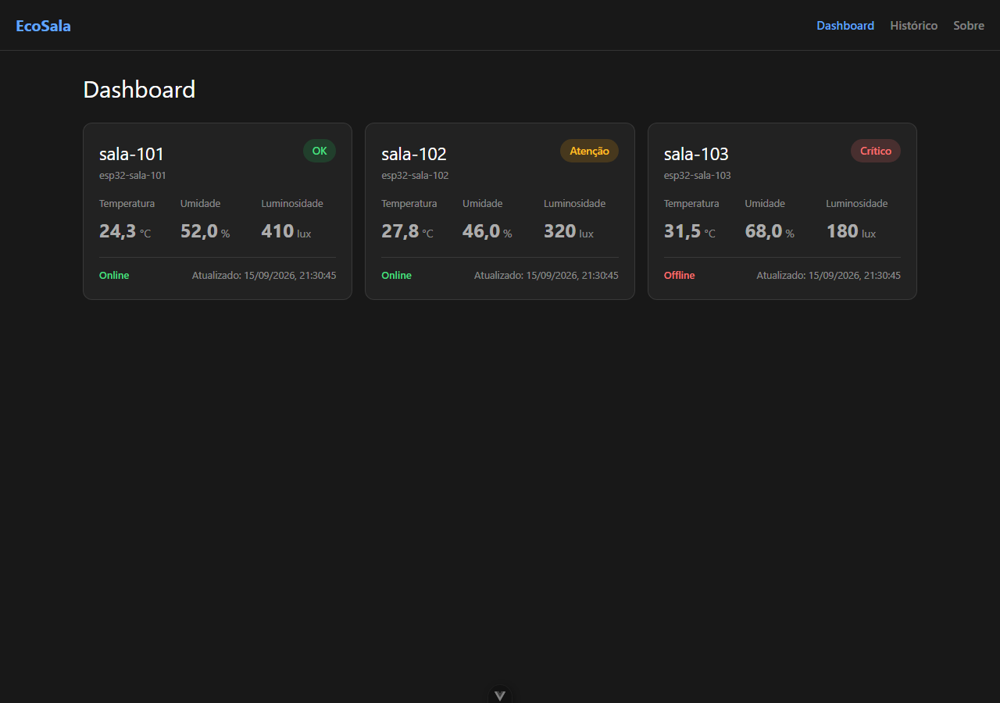
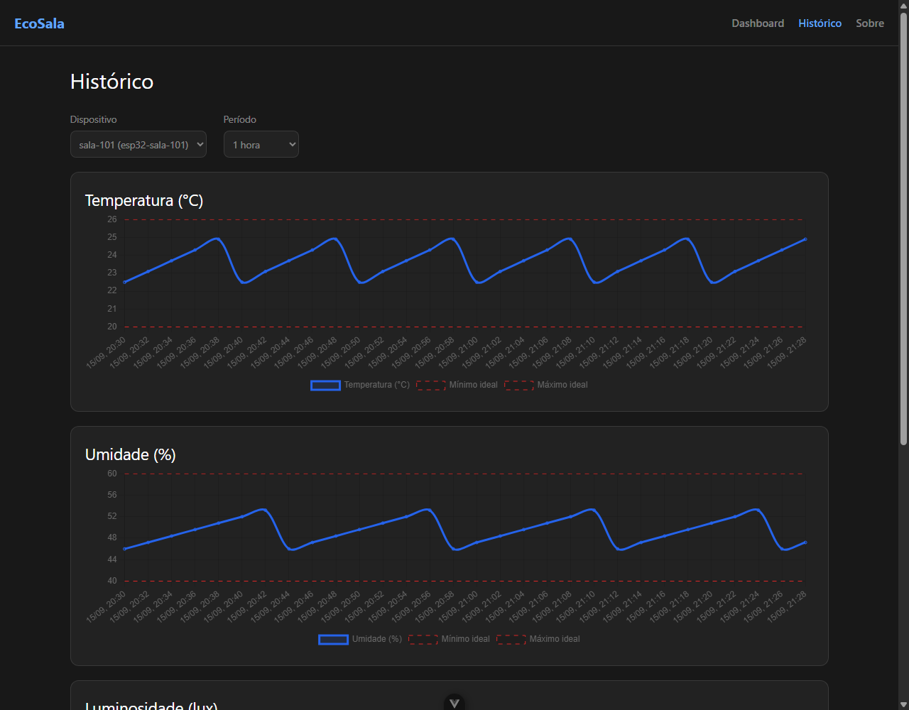

# EcoSala — Monitoramento de Conforto Ambiental em Salas de Aula

> Projeto acadêmico (Smart Campus) que monitora temperatura, umidade e
> luminosidade de salas de aula via ESP32 (Wokwi) + MQTT (Mosquitto) +
> Backend Python (FastAPI, Clean Architecture) + InfluxDB, com dashboard em
> Vue 3 + TypeScript.

## Integrantes do grupo

> Substitua pelos nomes reais do grupo.

- Integrante 1
- Integrante 2
- Integrante 3

## Sumário

- [O problema e a solução](#o-problema-e-a-solução)
- [Arquitetura](#arquitetura)
- [Screenshots](#screenshots)
- [Pré-requisitos](#pré-requisitos)
- [Instalação passo a passo](#instalação-passo-a-passo)
  - [1. Mosquitto](#1-mosquitto)
  - [2. InfluxDB](#2-influxdb)
  - [3. Backend](#3-backend)
  - [4. Frontend](#4-frontend)
  - [5. Firmware (Wokwi)](#5-firmware-wokwi)
- [Variáveis de ambiente](#variáveis-de-ambiente)
- [Como testar cada parte](#como-testar-cada-parte)
- [Scripts de conveniência](#scripts-de-conveniência)
- [Estrutura do repositório](#estrutura-do-repositório)
- [Roteiro de demonstração](#roteiro-de-demonstração)
- [Evolução para o 2º bimestre](#evolução-para-o-2º-bimestre)

## O problema e a solução

Salas de aula com temperatura alta, umidade inadequada ou pouca iluminação
reduzem a concentração e o rendimento dos alunos. Hoje a instituição não
possui dados para saber quais salas apresentam problemas, em quais
horários e com que frequência.

O EcoSala resolve isso com um ESP32 por sala (simulado no Wokwi) que mede
temperatura, umidade (DHT22) e luminosidade (fotoresistor) e publica via
MQTT. Um backend em Python consome as mensagens, classifica o conforto
(`OK` / `ATENCAO` / `CRITICO`) e grava no InfluxDB. Um dashboard em Vue
exibe os valores atuais e o histórico de cada sala.

Detalhes completos: [`docs/problema.md`](docs/problema.md).

## Arquitetura

```
ESP32 (Wokwi) → MQTT → Mosquitto → Backend Python (Clean Architecture) → InfluxDB → API REST → Dashboard Vue
```

Diagrama completo, decisões técnicas e plano de evolução para o 2º
bimestre: [`docs/arquitetura.md`](docs/arquitetura.md). Contrato MQTT
(tópicos e payloads): [`docs/contrato-mqtt.md`](docs/contrato-mqtt.md).

## Screenshots

**Dashboard** — cards de temperatura/umidade/luminosidade, status de
conforto colorido (OK/Atenção/Crítico) e indicador online/offline por sala:



**Histórico** — gráficos de linha por métrica com linhas de referência das
faixas ideais, seleção de dispositivo/período:



## Pré-requisitos

| Ferramenta | Versão sugerida |
|---|---|
| Python | 3.12+ |
| Node.js | 22+ |
| Mosquitto | 2.x |
| InfluxDB | 2.x (OSS) |
| VS Code + extensão **Wokwi for VS Code** | para simular o firmware |
| PlatformIO (extensão VS Code) | para compilar o firmware |

Windows: os binários de Mosquitto e InfluxDB podem ser baixados sem
instalador (veja `infra/mosquitto/` e `infra/influxdb/setup.md`) — não é
necessário privilégio de administrador.

## Instalação passo a passo

### 1. Mosquitto

Siga [`infra/mosquitto/mosquitto.conf`](infra/mosquitto/mosquitto.conf) e
[`infra/mosquitto/passwd.example`](infra/mosquitto/passwd.example) para
gerar o arquivo de senhas com os usuários `device` e `backend`:

```powershell
cd infra/mosquitto
mosquitto_passwd -c passwd device
mosquitto_passwd passwd backend
cd ../..
```

Inicie o broker **a partir da raiz do repositório** (mantenha rodando):

```powershell
mosquitto -c infra/mosquitto/mosquitto.conf -v
```

### 2. InfluxDB

Siga o passo a passo completo em
[`infra/influxdb/setup.md`](infra/influxdb/setup.md): instalar, iniciar o
`influxd`, criar organização/bucket/token via `influx setup`.

### 3. Backend

```powershell
cd backend
python -m venv .venv
.\.venv\Scripts\python.exe -m pip install -e ".[dev]"
copy .env.example .env
# edite .env: MQTT_PASSWORD, INFLUXDB_TOKEN etc. (valores do passo 1 e 2)
.\.venv\Scripts\python.exe -m uvicorn app.main:app --reload
```

A API sobe em `http://localhost:8000` — documentação interativa (Swagger)
em `http://localhost:8000/docs`.

### 4. Frontend

```powershell
cd frontend
npm install
copy .env.example .env
# edite .env se a API estiver em outro endereço
npm run dev
```

O dashboard sobe em `http://localhost:5173`.

### 5. Firmware (Wokwi)

Veja o passo a passo completo (incluindo a configuração do **Private IoT
Gateway** para o firmware simulado acessar o Mosquitto local) em
[`firmware/README.md`](firmware/README.md).

**Plano B sem Wokwi** — simulador Python que publica no mesmo formato do
firmware real:

```powershell
cd backend
.\.venv\Scripts\python.exe scripts\simulate_device.py --username device --password <senha_device>
```

## Variáveis de ambiente

### Backend (`backend/.env`, ver `backend/.env.example`)

| Variável | Descrição |
|---|---|
| `MQTT_HOST`, `MQTT_PORT` | Endereço do broker Mosquitto |
| `MQTT_USERNAME`, `MQTT_PASSWORD` | Credenciais do usuário `backend` |
| `INFLUXDB_URL`, `INFLUXDB_ORG`, `INFLUXDB_BUCKET`, `INFLUXDB_TOKEN` | Conexão com o InfluxDB |
| `COMFORT_TEMPERATURE_MIN_C` / `_MAX_C` | Faixa ideal de temperatura |
| `COMFORT_HUMIDITY_MIN_PERCENT` / `_MAX_PERCENT` | Faixa ideal de umidade |
| `COMFORT_LUMINOSITY_MIN_LUX` | Luminosidade mínima ideal |
| `COMFORT_*_CRITICAL_MARGIN_*` | Margens de tolerância (ATENCAO vs CRITICO) |
| `CORS_ALLOWED_ORIGIN` | Origem permitida (URL do frontend) |
| `LOG_LEVEL` | Nível de log (`INFO`, `DEBUG`, ...) |

### Frontend (`frontend/.env`, ver `frontend/.env.example`)

| Variável | Descrição |
|---|---|
| `VITE_API_BASE_URL` | URL base da API (ex.: `http://localhost:8000/api/v1`) |

## Como testar cada parte

### Mosquitto

```powershell
mosquitto_sub -h localhost -p 1883 -u backend -P <senha> -t 'ecosala/#' -v
```

### Backend — testes automatizados

```powershell
cd backend
.\.venv\Scripts\python.exe -m pytest -v      # 39 passed, 3 skipped sem MQTT/InfluxDB rodando
.\.venv\Scripts\python.exe -m ruff check app tests
.\.venv\Scripts\python.exe -m mypy app
```

Com Mosquitto e InfluxDB rodando, os 3 testes de integração
(`tests/integration/`) também passam.

### Backend — manual (Swagger)

Acesse `http://localhost:8000/docs` e teste `/api/v1/health`,
`/api/v1/devices`, `/api/v1/readings/latest`, `/api/v1/readings/history`,
`/api/v1/comfort/thresholds`.

### InfluxDB — Data Explorer

`http://localhost:8086` → **Data Explorer** → bucket `ecosala` →
measurement `environment`.

### Frontend — testes automatizados

```powershell
cd frontend
npm run type-check
npm run lint
npx vitest run
```

### Frontend — manual

Com o backend rodando, abra `http://localhost:5173` e navegue entre
Dashboard / Histórico / Sobre.

## Scripts de conveniência

| Script | O que faz |
|---|---|
| `scripts/check-backend.ps1` | pytest + ruff + mypy --strict |
| `scripts/check-frontend.ps1` | vue-tsc + lint (oxlint/eslint) + vitest |
| `scripts/run-backend.ps1` | sobe a API (uvicorn --reload) |
| `scripts/run-frontend.ps1` | sobe o dashboard (Vite dev server) |

## Estrutura do repositório

```
ecosala/
├── docs/            # documentação (problema, arquitetura, contrato MQTT, screenshots)
├── firmware/        # ESP32 / Wokwi + simulador Python (backend/scripts/simulate_device.py)
├── infra/           # Mosquitto e InfluxDB
├── backend/         # FastAPI + Clean Architecture (domain/application/infrastructure/presentation)
├── frontend/        # Vue 3 + TypeScript + Vite
└── scripts/         # scripts de lint/teste/execução
```

## Roteiro de demonstração

Checklist e roteiro completo para a apresentação:
[`docs/roteiro-demonstracao.md`](docs/roteiro-demonstracao.md).

## Evolução para o 2º bimestre

Novos sensores, atuadores/comunicação bidirecional, banco relacional e
Docker — tudo documentado em
[`docs/arquitetura.md`](docs/arquitetura.md#4-evolução-para-o-2º-bimestre).
