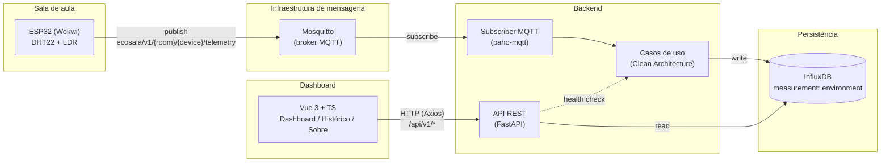

# Arquitetura — EcoSala

## 1. Visão geral do fluxo



## 2. Decisões técnicas

### 2.1 Por que Clean Architecture no backend

O backend precisa trocar peças com baixo custo entre bimestres (ex.: trocar
InfluxDB por outro banco, adicionar um broker diferente, adicionar um banco
relacional). Isolando o domínio (entidades e regras de negócio puras) de
frameworks e bibliotecas externas, essas trocas afetam apenas a camada de
`infrastructure`, sem tocar em regras de negócio já testadas.

Camadas (de dentro para fora):

1. **domain** — entidades (`Reading`), value objects (`ComfortStatus`),
   serviços de domínio (`ComfortEvaluator`) e *ports* (interfaces como
   `ReadingRepository`, `MessageSubscriber`). Não importa FastAPI, paho-mqtt,
   InfluxDB nem Pydantic de infraestrutura.
2. **application** — casos de uso (`IngestReading`, `GetLatestReadings`,
   `GetReadingHistory`, `ListDevices|Devices`) que orquestram o domínio através
   dos ports, recebidos por injeção de dependência.
3. **infrastructure** — adaptadores concretos: assinante MQTT
   (`paho_subscriber.py`) e repositório InfluxDB (`influx_reading_repository.py`).
   Implementam os ports definidos no domínio.
4. **presentation** — rotas HTTP (FastAPI), conversão HTTP ↔ DTO, chamando
   casos de uso. Não contém regra de negócio.

A composição final (qual implementação concreta de cada port será usada)
acontece em um único lugar: `backend/app/main.py`, usando o `lifespan` do
FastAPI para inicializar e encerrar o cliente MQTT e a conexão com o InfluxDB.

### 2.2 Por que MQTT + broker dedicado

MQTT é o padrão de fato para telemetria IoT: leve, com QoS, LWT (Last Will and
Testament) para detectar dispositivos offline, e desacopla o dispositivo do
backend (nenhum dos dois precisa saber o endereço do outro, apenas do broker).

### 2.3 Por que InfluxDB

As leituras são séries temporais (valor + timestamp, com tags de
`device_id`/`room_id`). InfluxDB é otimizado para esse padrão de escrita
(alto volume, pequenas escritas) e consulta (agregações por janela de tempo),
o que seria mais custoso de implementar manualmente em um banco relacional
para este caso de uso.

### 2.4 Por que Vue 3 + Composition API + TypeScript

Tipagem estática reduz erros de integração com a API (contratos de `Reading`,
`Device`, `ComfortStatus` espelhando o backend). A Composition API com
`<script setup>` favorece composables reutilizáveis (`usePolling`,
`useReadings`) e componentes pequenos e testáveis.

### 2.5 Sem Docker neste bimestre (mas preparado para)

Mosquitto e InfluxDB rodam instalados localmente neste bimestre. Todas as
credenciais, hosts e portas são lidos de variáveis de ambiente (`.env`), nunca
hardcoded — isso significa que adicionar um `docker-compose.yml` no 2º
bimestre é uma mudança apenas de infraestrutura, sem alterar nenhuma linha de
código de aplicação.

## 3. Estrutura de pastas (monorepo)

```
ecosala/
├── docs/            # documentação (este arquivo, problema, contrato MQTT)
├── firmware/        # projeto Wokwi (ESP32 + DHT22 + LDR)
├── infra/           # configuração de Mosquitto e InfluxDB
├── backend/         # FastAPI + Clean Architecture
└── frontend/        # Vue 3 + TypeScript + Vite
```

Detalhamento de `backend/app/` e `frontend/src/` será apresentado nas etapas
correspondentes (4 a 7), conforme cada camada é implementada.

## 4. Evolução para o 2º bimestre

O objetivo desta seção é registrar **como** cada extensão futura se encaixa
na arquitetura atual sem exigir reescrita.

### 4.1 Novos sensores

Um novo sensor (ex.: CO₂, presença) adiciona:
- um novo campo (`field`) no payload MQTT e no schema de validação
  (`payload_schema.py`);
- um novo atributo na entidade `Reading` (domínio) e no DTO correspondente;
- um novo card no dashboard (`components/dashboard/`).

Nenhuma mudança é necessária nos ports, nos casos de uso existentes ou no
repositório InfluxDB (que já grava fields dinamicamente).

### 4.2 Atuadores e comunicação bidirecional

O tópico `ecosala/v1/{room_id}/{device_id}/command` já está reservado no
contrato MQTT (`docs/contrato-mqtt.md`). Para suportar comandos:

- criar um novo port no domínio, `CommandPublisher` (ex.:
  `domain/ports/command_publisher.py`), com um método como
  `publish(device_id, command)`;
- implementar esse port em `infrastructure/mqtt/` (publicando no tópico
  `command`);
- adicionar um caso de uso `SendDeviceCommand` na camada `application`;
- expor uma rota `POST /api/v1/devices/{device_id}/commands` na
  `presentation`.

O domínio central (entidades, `ComfortEvaluator`) permanece intocado.

### 4.3 Banco relacional (ex.: PostgreSQL)

Cadastro de salas, dispositivos e usuários é um problema diferente do
armazenamento de séries temporais (é dado relacional, com baixa taxa de
mudança). A solução é adicionar novos ports (`RoomRepository`,
`DeviceRepository`, `UserRepository`) e implementá-los com um adaptador
PostgreSQL (ex.: SQLAlchemy) em `infrastructure/postgres/`, sem alterar o
repositório InfluxDB existente — cada banco resolve o problema para o qual é
adequado.

### 4.4 Docker

Planeja-se um `docker-compose.yml` na raiz do repositório com serviços
`mosquitto`, `influxdb`, `backend` e `frontend`. Como toda configuração já é
feita via variáveis de ambiente (`.env` / `.env.example`), a containerização
se resume a:
- criar `Dockerfile` para `backend/` e `frontend/`;
- mapear os `.env` existentes como variáveis de ambiente dos containers;
- montar os volumes de configuração já existentes em `infra/` (Mosquitto) e
  os volumes de dados do InfluxDB.

Nenhum código de aplicação precisa mudar para essa migração.
